# Cypress E2E Testing Framework for SauceDemo

A comprehensive end-to-end testing framework built with Cypress, TypeScript, and Page Object Model for testing the SauceDemo website.

---
**Author:** Devdun K  
**Created:** 2025  
**License:** MIT (Attribution Required)  
**Repository:** https://github.com/devdun/Cypress_Sample_1  
---

## 📄 License & Attribution

**🆓 FREE TO USE** - This project is open source and free to use with attribution requirements.

### ⚠️ **IMPORTANT**: Attribution is Required

When using this code in your projects:
- ✅ **Must include attribution** to "Devdun K" in your documentation
- ✅ **Must maintain the LICENSE file** if redistributing
- ✅ **Commercial use is permitted** with proper attribution
- ✅ **Modifications are welcome** - just keep the attribution

### 🙏 How to Give Credit

**In your project documentation:**
```
This project uses Cypress testing framework examples created by Devdun K.
Original repository: https://github.com/devdun/Cypress_Sample_1
```

**In code comments (for significant portions):**
```typescript
/**
 * Cypress testing implementation inspired by Devdun K's framework
 * Source: https://github.com/devdun/Cypress_Sample_1
 */
```

### 📞 Questions about Licensing?
Have questions about commercial use or licensing? Feel free to reach out!

---

## 🚀 Features

- **TypeScript Support**: Full TypeScript integration for better code maintainability
- **Advanced Page Object Model**: Separated selector architecture for maximum maintainability
- **Cross-Browser Testing**: Support for Chrome and Firefox
- **Responsive Testing**: Different viewport sizes (Mobile, Tablet, Desktop)
- **Custom Commands**: Reusable commands for common actions
- **Comprehensive Test Coverage**: Login, Products, Cart, Checkout, and E2E flows
- **Data-Driven Testing**: JSON fixtures for test data management
- **Centralized Selectors**: Improved maintainability with dedicated selector files
- **Mock Data Support**: Comprehensive API mocking with cy.intercept() for offline testing
- **Detailed Reporting**: Screenshots, videos, and detailed test reports
- **CI/CD Ready**: Configured for continuous integration

## 🏗️ Architecture Overview

The following diagram illustrates the comprehensive architecture of this Cypress E2E testing framework, showing the layered design pattern and component relationships:

```mermaid
graph TD
    %% Main Architecture Overview
    subgraph "🏗️ Cypress E2E Testing Framework Architecture"
        
        %% Test Layer
        subgraph "🎯 Test Layer"
            AUTH["🔐 Authentication Tests<br/>login.cy.ts<br/>user-roles.cy.ts<br/>(27 tests)"]
            PRODUCTS["🛍️ Product Tests<br/>product-display.cy.ts<br/>product-sorting.cy.ts<br/>(11 tests)"]
            CART["🛒 Cart Tests<br/>add-to-cart.cy.ts<br/>cart-management.cy.ts<br/>(14 tests)"]
            CHECKOUT["💳 Checkout Tests<br/>checkout-flow.cy.ts<br/>(9 tests)"]
            WORKFLOWS["🔄 Workflow Tests<br/>complete-flow.cy.ts<br/>navigation.cy.ts<br/>(20 tests)"]
            MOCK["🎭 Mock Data Tests<br/>mock-examples.cy.ts<br/>(26 tests)"]
        end
        
        %% Page Object Layer
        subgraph "📄 Page Object Model Layer"
            LOGIN_PAGE["🔐 LoginPage.ts<br/>• login()<br/>• validateError()<br/>• validateLockedOut()"]
            PRODUCTS_PAGE["🛍️ ProductsPage.ts<br/>• sortProducts()<br/>• addToCart()<br/>• validateCount()"]
            CART_PAGE["🛒 CartPage.ts<br/>• removeItem()<br/>• validateCartItem()<br/>• proceedToCheckout()"]
            CHECKOUT_PAGE["💳 CheckoutPage.ts<br/>• fillForm()<br/>• validateSummary()<br/>• completeOrder()"]
        end
        
        %% Selector Layer
        subgraph "🎯 Selector Layer"
            LOGIN_SEL["LoginPageSelectors.ts<br/>• usernameField<br/>• passwordField<br/>• loginButton<br/>• errorMessage"]
            PRODUCTS_SEL["ProductsPageSelectors.ts<br/>• productGrid<br/>• sortDropdown<br/>• addToCartButton<br/>• shoppingCart"]
            CART_SEL["CartPageSelectors.ts<br/>• cartItem<br/>• removeButton<br/>• checkoutButton<br/>• itemQuantity"]
            CHECKOUT_SEL["CheckoutPageSelectors.ts<br/>• firstNameField<br/>• lastNameField<br/>• zipCodeField<br/>• finishButton"]
        end
        
        %% Support Layer
        subgraph "🛠️ Support Layer"
            COMMANDS["⚡ Custom Commands<br/>commands.ts<br/>• cy.login()<br/>• cy.addToCart()<br/>• cy.clearCart()"]
            E2E_SETUP["🔧 Global Setup<br/>e2e.ts<br/>• Import commands<br/>• Global hooks<br/>• Configuration"]
        end
        
        %% Utility Layer
        subgraph "🔧 Utility Layer"
            TEST_HELPER["📊 TestDataHelper.ts<br/>• User management<br/>• Data validation<br/>• Test scenarios"]
            MOCK_HELPER["🎭 MockDataHelper.ts<br/>• API interception<br/>• Mock responses<br/>• Network simulation"]
        end
        
        %% Data Layer
        subgraph "📊 Data Layer"
            USER_DATA["👥 users.json<br/>• Standard user<br/>• Locked user<br/>• Problem user"]
            PRODUCT_DATA["🛍️ products.json<br/>• Product mock data<br/>• Scenarios"]
            CART_DATA["🛒 cart.json<br/>• Cart mock data<br/>• State scenarios"]
            API_DATA["📡 api-responses.json<br/>• API mocks<br/>• Response templates"]
        end
        
        %% Configuration Layer
        subgraph "⚙️ Configuration Layer"
            CYPRESS_CONFIG["🔧 cypress.config.ts<br/>• Base URL<br/>• Browser settings<br/>• Timeouts<br/>• Viewports"]
            TS_CONFIG["🔧 tsconfig.json<br/>• TypeScript config<br/>• Type definitions<br/>• Path mappings"]
            PACKAGE_JSON["📦 package.json<br/>• Dependencies<br/>• 47+ NPM scripts<br/>• Project metadata"]
        end
        
        %% Execution Flow
        subgraph "🚀 Execution Flow"
            RUNNER["🎮 Cypress Runner<br/>• Interactive mode<br/>• Headless mode<br/>• Cross-browser"]
            REPORTS["📊 Test Reports<br/>• Screenshots<br/>• Videos<br/>• Detailed logs"]
        end
        
        %% Application Under Test
        subgraph "🎯 Application Under Test"
            SAUCEDEMO["🌐 SauceDemo Website<br/>https://saucedemo.com<br/>• Login page<br/>• Products page<br/>• Cart page<br/>• Checkout page"]
        end
    end
    
    %% Relationships - Test Layer to Page Objects
    AUTH --> LOGIN_PAGE
    AUTH --> PRODUCTS_PAGE
    PRODUCTS --> PRODUCTS_PAGE
    CART --> CART_PAGE
    CART --> PRODUCTS_PAGE
    CHECKOUT --> CHECKOUT_PAGE
    WORKFLOWS --> LOGIN_PAGE
    WORKFLOWS --> PRODUCTS_PAGE
    WORKFLOWS --> CART_PAGE
    WORKFLOWS --> CHECKOUT_PAGE
    MOCK --> MOCK_HELPER
    
    %% Page Objects to Selectors
    LOGIN_PAGE --> LOGIN_SEL
    PRODUCTS_PAGE --> PRODUCTS_SEL
    CART_PAGE --> CART_SEL
    CHECKOUT_PAGE --> CHECKOUT_SEL
    
    %% Support Layer Usage
    AUTH --> COMMANDS
    PRODUCTS --> COMMANDS
    CART --> COMMANDS
    CHECKOUT --> COMMANDS
    WORKFLOWS --> COMMANDS
    
    %% Utility Layer Usage
    AUTH --> TEST_HELPER
    PRODUCTS --> TEST_HELPER
    CART --> TEST_HELPER
    CHECKOUT --> TEST_HELPER
    WORKFLOWS --> TEST_HELPER
    MOCK --> MOCK_HELPER
    
    %% Data Layer Usage
    AUTH --> USER_DATA
    PRODUCTS --> PRODUCT_DATA
    CART --> CART_DATA
    MOCK --> API_DATA
    
    %% Configuration Usage
    RUNNER --> CYPRESS_CONFIG
    RUNNER --> TS_CONFIG
    RUNNER --> PACKAGE_JSON
    
    %% Execution Flow
    RUNNER --> AUTH
    RUNNER --> PRODUCTS
    RUNNER --> CART
    RUNNER --> CHECKOUT
    RUNNER --> WORKFLOWS
    RUNNER --> MOCK
    RUNNER --> REPORTS
    
    %% Application Interaction
    LOGIN_PAGE --> SAUCEDEMO
    PRODUCTS_PAGE --> SAUCEDEMO
    CART_PAGE --> SAUCEDEMO
    CHECKOUT_PAGE --> SAUCEDEMO
    
    %% Setup Dependencies
    E2E_SETUP --> COMMANDS
    E2E_SETUP --> CYPRESS_CONFIG
    
    %% Styling
    classDef testLayer fill:#e1f5fe,stroke:#0277bd,stroke-width:2px
    classDef pageLayer fill:#f3e5f5,stroke:#7b1fa2,stroke-width:2px
    classDef selectorLayer fill:#e8f5e8,stroke:#388e3c,stroke-width:2px
    classDef supportLayer fill:#fff3e0,stroke:#f57c00,stroke-width:2px
    classDef utilityLayer fill:#fce4ec,stroke:#c2185b,stroke-width:2px
    classDef dataLayer fill:#e0f2f1,stroke:#00695c,stroke-width:2px
    classDef configLayer fill:#f1f8e9,stroke:#558b2f,stroke-width:2px
    classDef executionLayer fill:#e8eaf6,stroke:#303f9f,stroke-width:2px
    classDef appLayer fill:#fff8e1,stroke:#ff8f00,stroke-width:2px
    
    class AUTH,PRODUCTS,CART,CHECKOUT,WORKFLOWS,MOCK testLayer
    class LOGIN_PAGE,PRODUCTS_PAGE,CART_PAGE,CHECKOUT_PAGE pageLayer
    class LOGIN_SEL,PRODUCTS_SEL,CART_SEL,CHECKOUT_SEL selectorLayer
    class COMMANDS,E2E_SETUP supportLayer
    class TEST_HELPER,MOCK_HELPER utilityLayer
    class USER_DATA,PRODUCT_DATA,CART_DATA,API_DATA dataLayer
    class CYPRESS_CONFIG,TS_CONFIG,PACKAGE_JSON configLayer
    class RUNNER,REPORTS executionLayer
    class SAUCEDEMO appLayer
```



### 🎯 **Architecture Layers Explained**

| Layer | Purpose | Components | Responsibilities |
|-------|---------|------------|------------------|
| **🎯 Test Layer** | Test specifications and scenarios | 6 test categories | Define test cases, assertions, and workflows |
| **📄 Page Object Model Layer** | Page interactions and methods | 4 page objects | Encapsulate page-specific logic and interactions |
| **🎯 Selector Layer** | UI element selectors | 4 selector files | Centralize and maintain UI element selectors |
| **🛠️ Support Layer** | Framework support and utilities | Custom commands, global setup | Provide reusable functions and global configuration |
| **🔧 Utility Layer** | Helper functions and utilities | Test data helper, mock data helper | Manage test data and mock responses |
| **📊 Data Layer** | Test data and fixtures | JSON fixture files | Store test data, user credentials, and mock responses |
| **⚙️ Configuration Layer** | Framework configuration | Config files | Define Cypress, TypeScript, and project settings |
| **🚀 Execution Layer** | Test execution and reporting | Cypress runner, reports | Execute tests and generate reports |
| **🎯 Application Under Test** | Target application | SauceDemo website | The web application being tested |

### 🔄 **Data Flow & Relationships**

1. **Test Execution Flow**: Tests → Page Objects → Selectors → Application
2. **Support Integration**: Tests → Custom Commands → Global Setup
3. **Data Management**: Tests → Utilities → Fixtures → Test Data
4. **Configuration**: Runner → Configuration Files → Test Environment
5. **Reporting**: Execution → Screenshots/Videos → Test Reports

### 🏗️ **Key Architectural Benefits**

- **🎯 Separation of Concerns**: Each layer has a specific responsibility
- **🔄 Reusability**: Page objects and utilities can be reused across tests
- **🛠️ Maintainability**: Centralized selectors and configuration
- **📊 Scalability**: Easy to add new tests, pages, and utilities
- **🧪 Type Safety**: Full TypeScript integration across all layers
- **🎭 Flexibility**: Mock data support for offline testing
- **📈 Extensibility**: Modular design supports future enhancements

## 📁 Complete Project Structure

```
CYPRESS_DEVDUN/
├── cypress/                           # Cypress test framework
│   ├── e2e/                          # 🎯 End-to-end test specifications (organized by category)
│   │   ├── auth/                     # 🔐 Authentication & user management tests
│   │   │   ├── login.cy.ts           # Login functionality tests (15 tests)
│   │   │   └── user-roles.cy.ts      # Special user behaviors & session management (12 tests)
│   │   ├── products/                 # 🛍️ Product-related functionality tests
│   │   │   ├── product-display.cy.ts # Product listing, details, navigation (6 tests)
│   │   │   └── product-sorting.cy.ts # Product sorting & filtering (5 tests)
│   │   ├── cart/                     # 🛒 Shopping cart functionality tests
│   │   │   ├── add-to-cart.cy.ts     # Adding items to cart (7 tests)
│   │   │   └── cart-management.cy.ts # Cart operations & state management (7 tests)
│   │   ├── checkout/                 # 💳 Checkout process tests
│   │   │   └── checkout-flow.cy.ts   # Complete checkout flow & validation (9 tests)
│   │   ├── workflows/                # 🔄 Complete user journey tests
│   │   │   ├── complete-flow.cy.ts   # End-to-end shopping workflows (7 tests)
│   │   │   └── navigation.cy.ts      # Navigation & menu interactions (13 tests)
│   │   ├── mock-data/                # 🎭 Mock data & API testing
│   │   │   └── mock-examples.cy.ts   # Mock data integration examples (26 tests)
│   │   └── README.md                 # E2E test organization documentation
│   ├── pages/                        # 📄 Page Object Models
│   │   ├── selectors/                # 🎯 Centralized selectors (separated architecture)
│   │   │   ├── LoginPageSelectors.ts      # Login page selectors
│   │   │   ├── ProductsPageSelectors.ts   # Products page selectors
│   │   │   ├── CartPageSelectors.ts       # Cart page selectors
│   │   │   └── CheckoutPageSelectors.ts   # Checkout page selectors
│   │   ├── LoginPage.ts              # Login page objects & methods
│   │   ├── ProductsPage.ts           # Products page objects & methods
│   │   ├── CartPage.ts               # Cart page objects & methods
│   │   └── CheckoutPage.ts           # Checkout page objects & methods
│   ├── fixtures/                     # 📊 Test data & mock responses
│   │   ├── users.json                # User credentials & test data
│   │   ├── products.json             # Product mock data & scenarios
│   │   ├── cart.json                 # Cart mock data & scenarios
│   │   └── api-responses.json        # API response mocks
│   ├── support/                      # 🛠️ Support files & custom commands
│   │   ├── commands.ts               # Custom Cypress commands
│   │   └── e2e.ts                    # Support file imports & global setup
│   ├── utils/                        # ⚡ Utility functions & helpers
│   │   ├── TestDataHelper.ts         # Test data management utilities (139 lines)
│   │   └── MockDataHelper.ts         # Mock data & API interception utilities (300+ lines)
│   ├── downloads/                    # 📥 Downloaded files during test execution
│   ├── screenshots/                  # 📸 Test failure screenshots
│   └── videos/                       # 🎬 Test execution videos
├── cypress.config.ts                 # ⚙️ Cypress framework configuration
├── package.json                      # 📦 Dependencies, scripts & project metadata
├── package-lock.json                 # 🔒 Dependency lock file
├── tsconfig.json                     # 🔧 TypeScript configuration
└── README.md                         # 📖 Project documentation (this file)
```

### 📊 Test Coverage Statistics

- **Total Test Files**: 10
- **Total Test Cases**: 101+
- **Test Categories**: 6 (Auth, Products, Cart, Checkout, Workflows, Mock Data)
- **Page Objects**: 4 (Login, Products, Cart, Checkout)
- **Utility Classes**: 2 (TestDataHelper, MockDataHelper)
- **Fixture Files**: 4 (Users, Products, Cart, API Responses)
- **Custom Commands**: 8 (login, addToCart, goToCart, etc.)
- **Mock Data Scenarios**: 50+ (Authentication, Products, Cart, Checkout, Network)

## 🛠️ Installation

### Prerequisites
- Node.js 22.x, 24.x, or 26+ (required by Cypress 16)
- npm or yarn

### Setup

1. **Clone the repository**:
   ```bash
   git clone <repository-url>
   cd CYPRESS_DEVDUN
   ```

2. **Install dependencies**:
   ```bash
   npm install
   ```

3. **Install Cypress types** (to resolve TypeScript errors):
   ```bash
   npm install --save-dev @types/cypress
   ```

## 🏃‍♂️ Comprehensive Test Execution Guide

This framework provides **47 different npm scripts** for comprehensive test execution across multiple browsers, modes, and test categories. Each command is carefully configured for specific use cases and optimized for different development workflows.

### 📋 Complete Command Reference

#### 🎯 **Core Commands**
```bash
# Basic execution
npm run cypress:open           # Interactive Test Runner (GUI)
npm run cypress:run            # Headless execution (all tests)
npm run cypress:run:headless   # Explicit headless mode
npm run test                   # Default test execution
npm run test:chrome            # All tests in Chrome
npm run test:firefox           # All tests in Firefox
```

#### 🔐 **Authentication Tests** (27 tests)
```bash
# Default browser execution
npm run test:auth              # All auth tests (headless)

# Browser-specific execution  
npm run test:auth:chrome       # Chrome headless
npm run test:auth:firefox      # Firefox headless
npm run test:auth:visual       # Chrome with UI (debugging)

# Legacy commands (specific test file)
npm run headless:login:chrome  # Login tests in Chrome
npm run headless:login:firefox # Login tests in Firefox
npm run visual:login           # Login tests with UI
```

#### 🛍️ **Product Tests** (11 tests)
```bash
# Category-wide execution
npm run test:products          # All product tests (headless)
npm run test:products:chrome   # Chrome headless
npm run test:products:firefox  # Firefox headless
npm run test:products:visual   # Chrome with UI
```

#### 🛒 **Cart Tests** (14 tests)
```bash
# Category-wide execution
npm run test:cart              # All cart tests (headless)
npm run test:cart:chrome       # Chrome headless
npm run test:cart:firefox      # Firefox headless
npm run test:cart:visual       # Chrome with UI

# Legacy commands (updated paths)
npm run headless:cart:chrome   # Cart tests in Chrome
npm run headless:cart:firefox  # Cart tests in Firefox
npm run visual:cart            # Cart tests with UI
```

#### 💳 **Checkout Tests** (9 tests)
```bash
# Category-wide execution
npm run test:checkout          # All checkout tests (headless)
npm run test:checkout:chrome   # Chrome headless
npm run test:checkout:firefox  # Firefox headless
npm run test:checkout:visual   # Chrome with UI
```

#### 🔄 **Workflow Tests** (20 tests)
```bash
# Category-wide execution
npm run test:workflows         # All workflow tests (headless)
npm run test:workflows:chrome  # Chrome headless
npm run test:workflows:firefox # Firefox headless
npm run test:workflows:visual  # Chrome with UI

# Legacy commands (specific test file)
npm run headless:e2e:chrome    # E2E tests in Chrome
npm run headless:e2e:firefox   # E2E tests in Firefox
npm run visual:e2e             # E2E tests with UI
```

#### 🎭 **Mock Data Tests** (26 tests)
```bash
# Category-wide execution
npm run test:mock-data         # All mock data tests (headless)
npm run test:mock-data:chrome  # Chrome headless
npm run test:mock-data:firefox # Firefox headless
npm run test:mock-data:visual  # Chrome with UI

# Complete mock suite execution
npm run test:all:mock          # All mock examples (headless)
npm run mock:examples:chrome   # Chrome headless
npm run mock:examples:firefox  # Firefox headless
npm run mock:examples:visual   # Chrome with UI

# Specific mock test scenarios
npm run test:mock:auth         # Authentication mock tests
npm run test:mock:products     # Product mock tests
npm run test:mock:cart         # Cart mock tests
npm run test:mock:checkout     # Checkout mock tests
npm run test:mock:network      # Network simulation tests
```

#### 🛠️ **Development & Quality Commands**
```bash
# Code quality
npm run lint                   # ESLint validation
npm run lint:fix               # Auto-fix ESLint errors
npm run format                 # Prettier formatting
npm run format:check           # Check formatting
```

## 🔧 Detailed Command Configuration

### 📋 Command Structure Breakdown

Each command follows a consistent pattern for predictable usage:

```bash
cypress run --browser chrome --headless --spec "cypress/e2e/auth/**/*.cy.ts"
│       │   │              │           │
│       │   │              │           └── Target: Specific files/patterns
│       │   │              └── Mode: UI visibility
│       │   └── Browser: Engine selection
│       └── Action: Run vs Open
└── Tool: Cypress CLI
```

### 🎯 Command Categories & Patterns

#### **Category-Based Commands**
```bash
Format: test:[category]:[browser]
Examples:
├── test:auth              # All auth tests (default browser)
├── test:auth:chrome       # Auth tests in Chrome
├── test:auth:firefox      # Auth tests in Firefox
└── test:auth:visual       # Auth tests with UI
```

#### **Legacy Commands** (Backward compatibility)
```bash
Format: [mode]:[type]:[browser]
Examples:
├── headless:login:chrome  # Login tests in Chrome (no UI)
├── headless:cart:firefox  # Cart tests in Firefox (no UI)
└── visual:e2e             # E2E tests in Chrome (with UI)
```

#### **Mock Data Commands**
```bash
Format: test:mock:[scenario]
Examples:
├── test:mock:auth         # Authentication mocking
├── test:mock:products     # Product data mocking
├── test:mock:cart         # Cart state mocking
├── test:mock:checkout     # Checkout flow mocking
└── test:mock:network      # Network condition simulation
```

### ⚙️ Implementation Details

#### **Complete Scripts Configuration**
```json
{
  "scripts": {
    // 🎯 Core Commands
    "cypress:open": "cypress open",
    "cypress:run": "cypress run",
    "cypress:run:headless": "cypress run --headless",
    "test": "cypress run",
    "test:chrome": "cypress run --browser chrome",
    "test:firefox": "cypress run --browser firefox",
    
    // 🔐 Authentication Tests (27 tests)
    "test:auth": "cypress run --headless --spec \"cypress/e2e/auth/**/*.cy.ts\"",
    "test:auth:chrome": "cypress run --browser chrome --headless --spec \"cypress/e2e/auth/**/*.cy.ts\"",
    "test:auth:firefox": "cypress run --browser firefox --headless --spec \"cypress/e2e/auth/**/*.cy.ts\"",
    "test:auth:visual": "cypress run --browser chrome --spec \"cypress/e2e/auth/**/*.cy.ts\"",
    
    // 🛍️ Product Tests (11 tests)
    "test:products": "cypress run --headless --spec \"cypress/e2e/products/**/*.cy.ts\"",
    "test:products:chrome": "cypress run --browser chrome --headless --spec \"cypress/e2e/products/**/*.cy.ts\"",
    "test:products:firefox": "cypress run --browser firefox --headless --spec \"cypress/e2e/products/**/*.cy.ts\"",
    "test:products:visual": "cypress run --browser chrome --spec \"cypress/e2e/products/**/*.cy.ts\"",
    
    // 🛒 Cart Tests (14 tests)
    "test:cart": "cypress run --headless --spec \"cypress/e2e/cart/**/*.cy.ts\"",
    "test:cart:chrome": "cypress run --browser chrome --headless --spec \"cypress/e2e/cart/**/*.cy.ts\"",
    "test:cart:firefox": "cypress run --browser firefox --headless --spec \"cypress/e2e/cart/**/*.cy.ts\"",
    "test:cart:visual": "cypress run --browser chrome --spec \"cypress/e2e/cart/**/*.cy.ts\"",
    
    // 💳 Checkout Tests (9 tests)
    "test:checkout": "cypress run --headless --spec \"cypress/e2e/checkout/**/*.cy.ts\"",
    "test:checkout:chrome": "cypress run --browser chrome --headless --spec \"cypress/e2e/checkout/**/*.cy.ts\"",
    "test:checkout:firefox": "cypress run --browser firefox --headless --spec \"cypress/e2e/checkout/**/*.cy.ts\"",
    "test:checkout:visual": "cypress run --browser chrome --spec \"cypress/e2e/checkout/**/*.cy.ts\"",
    
    // 🔄 Workflow Tests (20 tests)
    "test:workflows": "cypress run --headless --spec \"cypress/e2e/workflows/**/*.cy.ts\"",
    "test:workflows:chrome": "cypress run --browser chrome --headless --spec \"cypress/e2e/workflows/**/*.cy.ts\"",
    "test:workflows:firefox": "cypress run --browser firefox --headless --spec \"cypress/e2e/workflows/**/*.cy.ts\"",
    "test:workflows:visual": "cypress run --browser chrome --spec \"cypress/e2e/workflows/**/*.cy.ts\"",
    
    // 🎭 Mock Data Tests (26 tests)
    "test:mock-data": "cypress run --headless --spec \"cypress/e2e/mock-data/**/*.cy.ts\"",
    "test:mock-data:chrome": "cypress run --browser chrome --headless --spec \"cypress/e2e/mock-data/**/*.cy.ts\"",
    "test:mock-data:firefox": "cypress run --browser firefox --headless --spec \"cypress/e2e/mock-data/**/*.cy.ts\"",
    "test:mock-data:visual": "cypress run --browser chrome --spec \"cypress/e2e/mock-data/**/*.cy.ts\"",
    
    // 🎯 Specific Mock Scenarios
    "test:mock:auth": "cypress run --headless --spec \"cypress/e2e/mock-data/mock-examples.cy.ts\" --grep \"Authentication Mock Scenarios\"",
    "test:mock:products": "cypress run --headless --spec \"cypress/e2e/mock-data/mock-examples.cy.ts\" --grep \"Products Mock Scenarios\"",
    "test:mock:cart": "cypress run --headless --spec \"cypress/e2e/mock-data/mock-examples.cy.ts\" --grep \"Cart Mock Scenarios\"",
    "test:mock:checkout": "cypress run --headless --spec \"cypress/e2e/mock-data/mock-examples.cy.ts\" --grep \"Checkout Mock Scenarios\"",
    "test:mock:network": "cypress run --headless --spec \"cypress/e2e/mock-data/mock-examples.cy.ts\" --grep \"Network Condition Simulations\"",
    
    // 🔄 Legacy Commands (Backward Compatibility)
    "headless:cart:chrome": "cypress run --browser chrome --headless --spec \"cypress/e2e/cart/**/*.cy.ts\"",
    "headless:cart:firefox": "cypress run --browser firefox --headless --spec \"cypress/e2e/cart/**/*.cy.ts\"",
    "visual:cart": "cypress run --browser chrome --spec \"cypress/e2e/cart/**/*.cy.ts\"",
    "headless:login:chrome": "cypress run --browser chrome --headless --spec \"cypress/e2e/auth/login.cy.ts\"",
    "headless:login:firefox": "cypress run --browser firefox --headless --spec \"cypress/e2e/auth/login.cy.ts\"",
    "visual:login": "cypress run --browser chrome --spec \"cypress/e2e/auth/login.cy.ts\"",
    "headless:e2e:chrome": "cypress run --browser chrome --headless --spec \"cypress/e2e/workflows/complete-flow.cy.ts\"",
    "headless:e2e:firefox": "cypress run --browser firefox --headless --spec \"cypress/e2e/workflows/complete-flow.cy.ts\"",
    "visual:e2e": "cypress run --browser chrome --spec \"cypress/e2e/workflows/complete-flow.cy.ts\"",
    
    // 🎭 Mock Examples (Legacy)
    "mock:examples:chrome": "cypress run --browser chrome --headless --spec \"cypress/e2e/mock-data/mock-examples.cy.ts\"",
    "mock:examples:firefox": "cypress run --browser firefox --headless --spec \"cypress/e2e/mock-data/mock-examples.cy.ts\"",
    "mock:examples:visual": "cypress run --browser chrome --spec \"cypress/e2e/mock-data/mock-examples.cy.ts\"",
    "test:all:mock": "cypress run --headless --spec \"cypress/e2e/mock-data/mock-examples.cy.ts\"",
    
    // 🛠️ Development & Quality
    "lint": "eslint . --ext .ts,.js",
    "lint:fix": "eslint . --ext .ts,.js --fix",
    "format": "prettier --write \"**/*.{ts,js,json,md}\"",
    "format:check": "prettier --check \"**/*.{ts,js,json,md}\""
  }
}
```

### 🚀 Performance & Execution Analysis

#### **Execution Speed Comparison**
| Command Type | Avg Time | Tests | Browser | Mode | Resource Usage |
|-------------|----------|--------|---------|------|----------------|
| `test:auth` | ~22s | 27 | Default | Headless | 🔋 Low |
| `test:auth:chrome` | ~20s | 27 | Chrome | Headless | 🔋 Low |
| `test:auth:firefox` | ~28s | 27 | Firefox | Headless | 🔋 Low |
| `test:auth:visual` | ~35s | 27 | Chrome | Visual | 🔋🔋 Medium |
| `test:products` | ~15s | 11 | Default | Headless | 🔋 Low |
| `test:cart` | ~18s | 14 | Default | Headless | 🔋 Low |
| `test:checkout` | ~12s | 9 | Default | Headless | 🔋 Low |
| `test:workflows` | ~25s | 20 | Default | Headless | 🔋 Low |
| `test:mock-data` | ~45s | 26 | Default | Headless | 🔋 Low |

#### **Command Options Deep Dive**
| Option | Values | Impact | Use Case |
|--------|---------|--------|----------|
| `--browser` | chrome, firefox, edge, electron | Browser engine selection | Cross-browser testing |
| `--headless` | true/false | UI visibility | CI/CD vs debugging |
| `--spec` | file/pattern | Test file targeting | Focused testing |
| `--grep` | regex pattern | Test name filtering | Specific scenarios |
| `--config` | key=value | Runtime configuration | Environment-specific settings |
| `--env` | key=value | Environment variables | Test data configuration |

### 💡 Advanced Usage Examples

#### **Parallel Execution**
```bash
# Run multiple categories simultaneously
npm run test:auth & npm run test:products & npm run test:cart

# Cross-browser parallel testing
npm run test:auth:chrome & npm run test:auth:firefox
```

#### **Conditional Execution**
```bash
# Run products only if auth passes
npm run test:auth && npm run test:products

# Run visual if headless fails
npm run test:cart || npm run test:cart:visual
```

#### **Custom Configuration**
```bash
# Custom viewport testing
cypress run --config viewportWidth=1920,viewportHeight=1080 --spec "cypress/e2e/auth/**/*.cy.ts"

# Environment-specific testing
cypress run --env environment=staging --spec "cypress/e2e/workflows/**/*.cy.ts"

# Multiple specifications
cypress run --spec "cypress/e2e/auth/**/*.cy.ts,cypress/e2e/products/**/*.cy.ts"
```

### 🎯 Command Selection Strategy

#### **Development Phase**
```bash
# Feature development
npm run test:auth:visual        # Visual debugging
npm run test:products:chrome    # Fast feedback

# Bug fixing
npm run visual:login            # Specific issue investigation
npm run test:mock:auth          # Mock data validation
```

#### **Testing Phase**
```bash
# Smoke testing
npm run test:auth               # Critical path validation
npm run test:workflows:chrome   # User journey validation

# Regression testing
npm run test:chrome             # Full Chrome suite
npm run test:firefox            # Full Firefox suite
```

#### **CI/CD Pipeline Strategy**
```bash
# Stage 1: Fast feedback (20-30 seconds)
npm run test:auth:chrome

# Stage 2: Core functionality (40-50 seconds)
npm run test:products:chrome && npm run test:cart:chrome

# Stage 3: Complete flows (60-80 seconds)
npm run test:workflows:chrome

# Stage 4: Cross-browser validation (120+ seconds)
npm run test:firefox
```

### 🔧 Advanced Configuration & Customization

#### **Creating Custom Commands**
To add new commands to `package.json`:

```json
{
  "scripts": {
    // Custom mobile testing
    "mobile:auth:chrome": "cypress run --browser chrome --headless --spec \"cypress/e2e/auth/**/*.cy.ts\" --config viewportWidth=375,viewportHeight=667",
    
    // Custom API testing
    "api:mock:all": "cypress run --headless --spec \"cypress/e2e/mock-data/**/*.cy.ts\" --config baseUrl=http://localhost:3001",
    
    // Custom smoke testing
    "smoke:critical": "cypress run --headless --spec \"cypress/e2e/auth/login.cy.ts,cypress/e2e/workflows/complete-flow.cy.ts\""
  }
}
```

#### **Environment-Specific Commands**
```json
{
  "scripts": {
    // Development environment
    "test:dev:auth": "cypress run --env environment=development --spec \"cypress/e2e/auth/**/*.cy.ts\"",
    
    // Staging environment
    "test:staging:workflows": "cypress run --env environment=staging --spec \"cypress/e2e/workflows/**/*.cy.ts\"",
    
    // Production smoke tests
    "test:prod:smoke": "cypress run --env environment=production --spec \"cypress/e2e/auth/login.cy.ts\""
  }
}
```

### 🛠️ Troubleshooting & Best Practices

#### **Common Issues & Solutions**

##### **Command Not Found**
```bash
# Problem: npm run unknown:command
# Solution: List available commands
npm run

# Or check specific pattern
npm run | grep test:
```

##### **Browser Not Available**
```bash
# Problem: Browser 'firefox' not found
# Solution: Use alternative browser
npm run test:auth:chrome  # Instead of firefox

# Or install missing browser
# Chrome: Download from https://google.com/chrome
# Firefox: Download from https://mozilla.org/firefox
```

##### **Test Failures**
```bash
# Problem: Tests failing in headless mode
# Solution: Use visual mode for debugging
npm run test:auth:visual  # Instead of test:auth

# Or run specific failing test
npm run visual:login
```

##### **Performance Issues**
```bash
# Problem: Tests running slowly
# Solution: Use Chrome for fastest execution
npm run test:auth:chrome  # Fastest option

# Or run smaller test sets
npm run test:mock:auth    # Specific scenario
```

#### **Performance Optimization**

##### **Speed Optimization**
1. **Use Chrome** for fastest execution
2. **Use headless mode** for CI/CD
3. **Run specific categories** instead of all tests
4. **Use parallel execution** for large test suites

##### **Resource Management**
1. **Sequential execution** to avoid resource conflicts
2. **Monitor memory usage** during large test runs
3. **Clean up** between test runs if needed

#### **Best Practices**

##### **Command Naming**
- Use consistent prefixes (`test:`, `headless:`, `visual:`)
- Include browser specification (`:chrome`, `:firefox`)
- Specify mode clearly (`:visual` for UI)

##### **Usage Guidelines**
- **Development**: Use visual commands for debugging
- **Testing**: Use headless commands for speed
- **CI/CD**: Use default browser commands for consistency
- **Cross-browser**: Use specific browser commands

##### **Maintenance**
- **Regular updates** to reflect test structure changes
- **Performance monitoring** to identify slow commands
- **Documentation updates** when adding new commands

## 🎭 Mock Data Implementation

### Overview

This framework includes comprehensive mock data capabilities using Cypress's `cy.intercept()` functionality. Mock data allows you to:

- **Test without dependencies** - Run tests without relying on external APIs
- **Simulate edge cases** - Test error scenarios, timeouts, and network issues
- **Consistent test data** - Use predictable data for reliable tests
- **Faster execution** - Eliminate network latency and server response times
- **Offline testing** - Run tests without internet connectivity

### 📁 Mock Data Structure

```
cypress/
├── fixtures/
│   ├── products.json           # Product data & scenarios
│   ├── cart.json              # Cart states & scenarios
│   ├── api-responses.json     # API response mocks
│   └── users.json             # User data (existing)
├── utils/
│   ├── MockDataHelper.ts      # Mock data utilities
│   └── TestDataHelper.ts      # Enhanced with mock methods
└── e2e/
    └── mock-data-examples.cy.ts  # Example implementations
```

### 🔧 Mock Data Utilities

#### **MockDataHelper Class**

The `MockDataHelper` class provides fluent API for setting up mocks:

```typescript
import { MockDataHelper } from '../utils/MockDataHelper'

// Authentication mocks
MockDataHelper.mockAuth().success()
MockDataHelper.mockAuth().invalidCredentials()
MockDataHelper.mockAuth().serverError()
MockDataHelper.mockAuth().slowResponse(3000)

// Product mocks
MockDataHelper.mockProducts().success()
MockDataHelper.mockProducts().emptyInventory()
MockDataHelper.mockProducts().customProducts([...])

// Cart mocks
MockDataHelper.mockCart().addItemSuccess()
MockDataHelper.mockCart().addItemOutOfStock()
MockDataHelper.mockCart().getCartWithItems()

// Checkout mocks
MockDataHelper.mockCheckout().success()
MockDataHelper.mockCheckout().paymentError()
MockDataHelper.mockCheckout().validationError()
```

#### **Network Condition Simulation**

```typescript
// Simulate network conditions
MockDataHelper.simulateNetworkConditions().slowConnection(56)
MockDataHelper.simulateNetworkConditions().networkError('api/products')
MockDataHelper.simulateNetworkConditions().intermittentFailure('api/cart', 0.3)
MockDataHelper.simulateNetworkConditions().timeout('api/checkout')
```

### 🎯 Mock Data Usage Examples

#### **Basic Mock Setup**
```typescript
describe('Product Tests with Mock Data', () => {
  beforeEach(() => {
    // Setup product mocks
    MockDataHelper.mockProducts().success()
    MockDataHelper.mockCart().getCartEmpty()
  })

  it('should display products using mock data', () => {
    loginPage.visit()
    loginPage.login('standard_user', 'secret_sauce')
    
    // Verify mock was called
    MockDataHelper.waitForMockCall('productsSuccess')
    
    // Verify products are displayed
    productsPage.validateProductsAreDisplayed()
  })
})
```

#### **Error Scenario Testing**
```typescript
it('should handle product loading errors', () => {
  // Setup error mock
  MockDataHelper.mockProducts().serverError()
  
  loginPage.visit()
  loginPage.login('standard_user', 'secret_sauce')
  
  // Verify error handling
  MockDataHelper.waitForMockCall('productsServerError')
  cy.contains('Failed to load products').should('be.visible')
})
```

### 📊 Mock Data Benefits

#### **Development Benefits**
- ✅ **Independent Testing** - Tests don't depend on external services
- ✅ **Predictable Results** - Consistent test data every run
- ✅ **Edge Case Testing** - Easy to simulate error conditions
- ✅ **Faster Feedback** - No network latency or server delays
- ✅ **Offline Development** - Work without internet connectivity

#### **Testing Benefits**
- ✅ **Error Scenarios** - Test server errors, timeouts, network failures
- ✅ **Data Variations** - Test different product catalogs, pricing, inventory
- ✅ **Performance Testing** - Simulate slow connections and responses
- ✅ **Boundary Testing** - Test empty states, large datasets, edge cases
- ✅ **User Scenarios** - Test different user types and permissions

### 💡 Mock Data Best Practices

#### **When to Use Mock Data**
- ✅ **Unit-like E2E tests** - Testing specific component behavior
- ✅ **Error scenario testing** - Simulating failures and edge cases
- ✅ **Performance testing** - Testing under various network conditions
- ✅ **Development testing** - Quick validation during development
- ✅ **CI/CD pipelines** - Reliable automated testing

#### **When to Use Real Data**
- ✅ **Integration testing** - Testing actual API integration
- ✅ **End-to-end validation** - Full system testing
- ✅ **User acceptance testing** - Real user workflow validation
- ✅ **Production-like testing** - Testing against staging environments
- ✅ **Data validation** - Ensuring real data formats work correctly

### Specific Test Files
```bash
# Run only login tests
npx cypress run --spec "cypress/e2e/login.cy.ts"

# Run only end-to-end tests
npx cypress run --spec "cypress/e2e/e2e-complete-flow.cy.ts"
```

## 📊 Test Scenarios

### 🔐 Login Tests (`login.cy.ts`)
- ✅ Valid user logins (standard, problem, performance_glitch, error, visual users)
- ❌ Invalid credential handling
- 🔒 Locked out user scenarios
- 📱 Responsive login testing

### 🛍️ Product Tests (`products.cy.ts`)
- 📦 Product display and inventory
- 🛒 Add/remove items from cart
- 🔄 Product sorting functionality
- 🔍 Product navigation and details
- 👤 Different user type behaviors

### 🛒 Cart Tests
- 🧾 Cart item management
- 🔢 Cart quantity validation
- 💰 Price calculations
- 🚪 Cart navigation flows

### 💳 Checkout Tests
- 📝 Checkout form validation
- 🔄 Multi-step checkout process
- ❌ Error handling scenarios
- ✅ Order completion flows

### 🔄 End-to-End Tests (`e2e-complete-flow.cy.ts`)
- 🎯 Complete shopping journey
- 🔄 Cart modifications during flow
- ❌ Checkout cancellation scenarios
- 👥 Different user type flows
- 📱 Cross-browser compatibility

## 🎯 Test Data

### User Types
- **standard_user**: Regular user for standard testing
- **locked_out_user**: User that gets locked out
- **problem_user**: User with UI issues
- **performance_glitch_user**: User with performance issues
- **error_user**: User that encounters errors
- **visual_user**: User for visual testing

### Test Data Structure
```json
{
  "validUsers": {
    "standard_user": {
      "username": "standard_user",
      "password": "secret_sauce"
    }
  },
  "checkout": {
    "customer_info": {
      "firstName": "John",
      "lastName": "Doe",
      "zipCode": "12345"
    }
  }
}
```

## 🔧 Configuration

### Cypress Configuration (`cypress.config.ts`)
- **Base URL**: https://www.saucedemo.com
- **Viewport**: 1280x720 (configurable)
- **Timeouts**: Optimized for SauceDemo response times
- **Screenshots**: Enabled on failures
- **Videos**: Enabled for test runs

### TypeScript Configuration (`tsconfig.json`)
- **Target**: ES2020
- **Module**: CommonJS
- **Path Aliases**: Configured for easy imports
- **Strict Mode**: Enabled for better code quality

## 📝 Custom Commands

### Login Command
```typescript
cy.login('standard_user', 'secret_sauce')
```

### Cart Operations
```typescript
cy.addToCart('sauce-labs-backpack')
cy.goToCart()
```

### Checkout Flow
```typescript
cy.completeCheckout('John', 'Doe', '12345')
```

### Viewport Management
```typescript
cy.setViewportSize('mobile')  // or 'tablet', 'desktop'
```

## 📊 Reporting

### Test Results
- **Screenshots**: Captured on test failures
- **Videos**: Recorded for all test runs
- **Logs**: Detailed console output
- **Reports**: Available in `cypress/reports/`

### Viewing Results
```bash
# View test results
npx cypress run --reporter json --reporter-options "output=cypress/reports/results.json"
```

## 🔄 CI/CD Integration

### GitHub Actions Example
```yaml
name: Cypress Tests
on: [push, pull_request]
jobs:
  cypress-run:
    runs-on: ubuntu-latest
    steps:
      - uses: actions/checkout@v2
      - uses: cypress-io/github-action@v2
        with:
          build: npm run build
          start: npm start
          browser: chrome
```

## 📱 Cross-Browser Testing

### Supported Browsers
- ✅ Chrome (Default)
- ✅ Firefox
- ✅ Edge (with additional configuration)

### Browser-Specific Commands
```bash
# Chrome
npx cypress run --browser chrome

# Firefox
npx cypress run --browser firefox

# Headless mode
npx cypress run --browser chrome --headless
```

## 🎨 Page Object Model

### Architecture Overview
This framework uses a **separated selector pattern** for better maintainability and reusability:

- **Selector Files**: Centralized selectors in `cypress/pages/selectors/`
- **Page Objects**: Business logic and actions in `cypress/pages/`
- **Clear Separation**: UI locators separated from test logic

### Example Implementation

#### Selector File (`LoginPageSelectors.ts`)
```typescript
export const LoginPageSelectors = {
  usernameInput: '[data-test="username"]',
  passwordInput: '[data-test="password"]',
  loginButton: '[data-test="login-button"]',
  errorMessage: '[data-test="error"]',
  errorButton: '[data-test="error-button"]'
} as const;
```

#### Page Object (`LoginPage.ts`)
```typescript
import { LoginPageSelectors } from './selectors/LoginPageSelectors';

export class LoginPage {
  login(username: string, password: string): void {
    cy.get(LoginPageSelectors.usernameInput).type(username)
    cy.get(LoginPageSelectors.passwordInput).type(password)
    cy.get(LoginPageSelectors.loginButton).click()
  }

  getErrorMessage(): Cypress.Chainable<string> {
    return cy.get(LoginPageSelectors.errorMessage).invoke('text')
  }
}
```

### Benefits of This Architecture

1. **Maintainability**: Update selectors in one place when UI changes
2. **Reusability**: Share selectors across multiple page objects
3. **Type Safety**: TypeScript ensures selector consistency
4. **Testability**: Easy to validate selector changes
5. **Collaboration**: Developers can update selectors without touching test logic

## 🛠️ Utility Functions

### Test Data Helper
```typescript
import { TestDataHelper } from '../utils/TestDataHelper'

// Get user data
const user = TestDataHelper.getValidUser('standard_user')

// Get random product
const product = TestDataHelper.getRandomProduct()

// Take screenshot
TestDataHelper.takeScreenshot('test-failure')
```

## 📚 Best Practices

### 1. Test Organization
- Group related tests using `describe` blocks
- Use descriptive test names
- Follow the AAA pattern (Arrange, Act, Assert)

### 2. Page Object Model & Selectors
- **Centralized Selectors**: Keep all selectors in dedicated selector files
- **Separated Concerns**: Page objects contain logic, selector files contain locators
- **Consistent Naming**: Use descriptive names for selectors and methods
- **Type Safety**: Use `as const` for selector objects to ensure type safety
- **Reusability**: Share selectors across multiple page objects when needed

### 3. Data Management
- Use fixtures for test data
- Implement data helpers for dynamic data
- Keep sensitive data in environment variables

### 4. Error Handling
- Implement proper wait strategies
- Use appropriate timeouts
- Handle dynamic content properly

## 🐛 Troubleshooting

### Common Issues

1. **TypeScript Errors**
   ```bash
   npm install --save-dev @types/cypress
   ```

2. **Test Timeouts**
   - Increase timeout values in cypress.config.ts
   - Use proper wait strategies

3. **Element Not Found**
   - Verify selectors are correct
   - Check if element is in viewport
   - Add appropriate waits

4. **Browser Issues**
   - Clear browser cache
   - Update browser to latest version
   - Check browser-specific configurations

## 📄 License

This project is licensed under the ISC License.

## 🤝 Contributing

1. Fork the repository
2. Create a feature branch
3. Make your changes
4. Add tests for new features
5. Submit a pull request

## 📞 Support

For questions or issues:
- Create an issue in the repository
- Review the troubleshooting section
- Check Cypress documentation: https://docs.cypress.io

---

**Happy Testing! 🎉** 